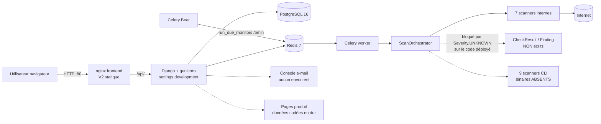
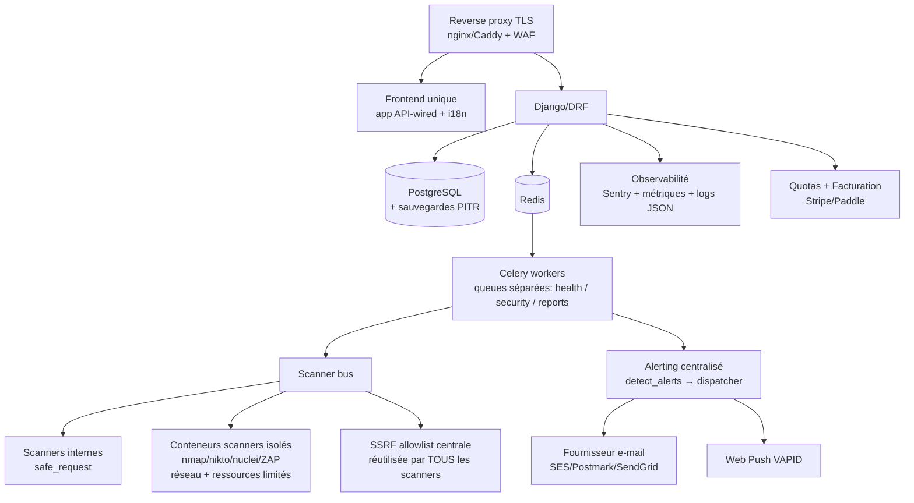

# AUDIT TECHNIQUE ET PRODUIT — `SaaS_Web_Application_digitale_presenz` (Presence)

**Date de l'audit :** 14 octobre 2026
**Auditeur :** Buffy (audit statique + dynamique, lecture seule)
**Portée :** dépôt local `~/Schreibtisch/SaaS_Web_Application_digitale_presenz`, stack Docker en cours d'exécution, code Git (branche `main`, dernier commit `3b2206f`), base PostgreSQL live, tests backend.
**Nature :** audit défensif. Aucun fichier, conteneur, migration ou donnée du projet n'a été modifié. La seule écriture effectuée est **ce rapport**, créé dans `audit/`.

---

## A. Résumé exécutif

**Le projet n'est pas dans l'état que sa documentation décrit.** Une grande partie du socle technique est réelle et de bonne qualité (modèle de données cohérent, API DRF structurée, couche SSRF `core/security.py` sérieuse, stack Docker opérationnelle avec healthchecks, 272 tests exécutés). Mais **le produit tel qu'il tourne aujourd'hui ne remplit pas sa promesse** :

1. **Le cœur du produit est cassé en production.** Les 2 626 scans présents en base sont tous marqués `completed` avec `health_score` NULL, **0 finding enregistré** et seulement 7 `CheckResult` au total ; les **18 067 `ScannerRun` sont tous en statut `failed`**. Cause racine identifiée avec certitude : `scanners/base.py` utilise `Severity.UNKNOWN`, attribut **inexistant**, ce qui fait échouer chaque scanner interne avant l'enregistrement du score et des findings (preuve : logs Celery du 14/10 12:20 + requêtes SQL). Ce bug est **déjà corrigé dans l'arbre de travail** (`Severity.INFO`) mais **le conteneur déployé exécute l'ancien code** : l'image en production ne correspond pas au dépôt.
2. **Le frontend déployé est une maquette Figma, pas une application.** Seul `AuthContext.tsx` appelle l'API. Toutes les pages produit (`Dashboard`, `Websites`, `WebsiteDetails`, `Scans`, `Monitoring`, `Alerts`, `Reports`…) affichent des **tableaux codés en dur** (`example.de`, score 92…), le bouton « Check my website » de la landing pointe vers `/onboarding` sans lancer de scan, et `PublicReport.tsx` contient un `DEMO_REPORT` explicitement commenté comme démo. L'application réellement connectée à l'API (l'ancien frontend `frontend/`, 26 pages, i18n fr/en/de/es, axios + JWT) **n'est plus déployée** et n'est plus alimentée.
3. **La pile tourne en configuration de développement** (`config.settings.development`) : `DEBUG=True`, `ALLOWED_HOSTS=['*']`, `CORS_ALLOW_ALL_ORIGINS=True` (vérifié : en-tête `access-control-allow-origin: *`), `SECURE_SSL_REDIRECT=False`, e-mails envoyés dans la console (donc **aucun e-mail réel** : vérification d'adresse, reset de mot de passe, alertes, rapports publics ne partent jamais). Aucun TLS.
4. **Failles d'autorisation confirmées par test HTTP** : `POST /api/v1/public/scan/<id>/convert/` réattribue `website.owner = request.user` **sans contrôle d'appartenance** (vol de site + historique) ; `GET /api/v1/public/scan/<id>/status/` renvoie les résultats complets de **n'importe quel** scan, y compris privé (`is_guest=False`) — vérifié en direct sur le scan 999 appartenant à un autre utilisateur. Le limiteur de débit public est contournable en forgeant `X-Forwarded-For`.
5. **Six migrations sont appliquées en base mais absentes du dépôt** (`websites.0004_scanner_engine`, `notifications.0002_webpushsubscription`, `analytics.0002`, `seo.0002`, `social.0002`, `advanced_security.0002`) et `makemigrations --check` signale des divergences sur 5 applications : une base neuve n'aurait **pas** le schéma de la base actuelle.
6. **Le volet commercial est à l'état de maquette** : plans et quotas modélisés mais **jamais appliqués**, aucune intégration de paiement, table `plans` vide (0 plan, 0 abonnement), pas de suppression de compte (RGPD), pas de support, PWA inopérante (aucun service worker), docs annonçant « 179 tests OK / 95 % prêt pour la production ».

**Niveau de maturité global estimé : 2,0 / 5** (« implémenté, non vérifié » sur le socle, « non opérationnel » sur le produit).
**Réussites réelles :** couche SSRF (`core/security.py`, 26 tests verts, épinglage DNS, revalidation des redirections, blocage des IP privées/métadonnées), pipeline scanner interne fonctionnel **après** correction (vérifié : score 85, 7 `CheckResult`, 7 findings sur une exécution réelle du code local), machine à états `Scan` avec `transition_to` + contraintes d'intégrité, Celery Beat actif (boucle de monitoring réellement déclenchée toutes les ~10 min), séparation correcte des données par propriétaire dans `websites`/`scans`, `.env` hors Git.
**Distance avant un lancement commercial :** la trajectoire « bêta privée » est courte (2 à 4 semaines) si l'on déploie le code corrigé et câble le frontend existant ; un lancement commercial limité suppose en plus quotas, paiement, e-mails transactionnels, suppression de compte et durcissement TLS/monitoring (≈ 2 à 3 mois).

---

## B. État actuel réel

### B.1 Terminé et vérifié (preuve de fonctionnement)
| Élément | Preuve |
|---|---|
| Stack Docker up (6 services) et saine | `docker compose ls` → `saas_web_application_digitale_presenz running(6)` ; `GET /api/v1/health/` → `{"status":"ok","dependencies":{"database":true,"redis":true}}` |
| Frontend servi | `curl http://localhost/` → HTTP 200, 3 216 octets, React charge sans erreur console (snapshot navigateur) |
| Celery worker + Beat actifs | `run_due_monitors: queued=…` loggé toutes les 5 min ; scans `monitoring` créés réellement (2 624 lignes) |
| Pipeline scanner interne (code local) | Test E2E isolé : `scan.status=completed`, `health_score=85`, 7 `CheckResult`, 7 `Finding`, 7 `ScannerRun completed` |
| SSRF `core/security.py` | 26 tests verts (`core/tests/test_security.py`) ; logs `ssrf_blocked_ip` pour `127.0.0.1`, `10.0.0.1`, `169.254.169.254`, `::1`, `fe80::1`, `fd00::ec2::254` |
| Auth JWT | `POST /auth/login` (mauvais mot de passe) → 401 ; `POST /auth/register` invalide → 400 avec messages ; `POST /auth/password/reset` → 202 (réponse non énumérante) ; rotation + blacklist des refresh tokens configurées |
| Modèles & contraintes clés | `UniqueConstraint(scan, category)`, `CheckConstraint` score 0-20 et 0-100, `Scan._TRANSITIONS`, `full_clean()` dans `transition_to` |
| OpenAPI | `/api/schema/` → 200 (OpenAPI 3.0.3) ; `/api/docs/` → 200 (Swagger) |

### B.2 Implémenté mais non vérifié / non opérationnel en l'état
- **Scans et scores** : code présent, tests verts, mais **production cassée** (0 finding, scores NULL) — voir E-01.
- **Monitoring planifié** : boucle Beat réelle, mais aucun résultat exploitable ; `consecutive_failures` / `escalation_level` jamais mis à jour (aucun appel à `record_failure`/`record_success`).
- **Alertes** : modèles, règles, fenêtres de silence, moteur d'escalade présents, **mais la tâche `alerts.tasks.detect_alerts` n'est appelée nulle part** (ni Beat, ni orchestrateur, ni signal) → table `alerts_alert` vide. Le sous-système d'alertes est du code mort.
- **Notifications** : `EMAIL_BACKEND=console` en production → rien n'est envoyé ; double implémentation `notifications/providers.py` vs `notifications/providers/` (le paquet gagne — vérifié : `__file__ = /app/notifications/providers/__init__.py`), les providers Webhook/Discord/SMS du module sont morts ; e-mail codé en dur `noreply@presence.local`.
- **Rapports** : génération PDF (WeasyPrint installé), tâche mensuelle planifiée, 1 ligne `reports_report` — mais l'endpoint attendu par le frontend (`/api/v1/reports/`) **n'existe pas** (404 ; les vraies routes sont `/generate/` et `/pdf/<scan_id>/`).
- **Scanners externes (nmap, nikto, nuclei, whatweb, testssl, dnsrecon, gobuster, feroxbuster, ZAP)** : adaptateurs, exécuteur durci (`shell=False`, env filtré, timeout, plafond de sortie) et parseurs présents, mais **aucun binaire installé dans l'image** → `is_available() = False` pour les 9. Le type de scan `security` et le module `advanced_security` sont inopérants.
- **SEO / Social / Advanced Security** : endpoints présents (`/websites/<id>/seo/audits/`, `/social/profiles/`, `/security/scan/`) mais **aucune page du frontend V2 ne les appelle**, et `advanced_security/scanners/malware.py` retourne une valeur codée en dur `{"threat_found": False}` (stub, alors que la doc annonce Google Safe Browsing) ; `social/tasks.py` génère de **fausses données** (`random.randint` sur les followers, mentions fictives).
- **Reviews** : analyse de sentiment réelle mais **lexicale** (listes de mots FR/EN/DE), pas d'IA/NLP ; découverte « réelle » = scraping Trustpilot via `safe_request` (protection SSRF OK, mais risque juridique/ToS).
- **PWA** : `manifest.json` présent, mais **aucun service worker** (`/sw.js` renvoie 200 `text/html` = fallback SPA ; aucun `sw.js` dans `public/` ; aucune registration `serviceWorker` dans `src/`) → non installable, pas d'offline, alors que la landing affiche « Works offline with cached data ».

### B.3 Absent
Paiement / facturation réelle, application des quotas, organisations/équipes, rôles fins, e-mails transactionnels réels, suppression de compte et export de données (RGPD), brute-force protection (login/reset non throttlés), 2FA, support client, analytics produit, sauvegardes/restauration, rollback, CI fonctionnelle, déploiement automatisé, TLS/HTTPS, monitoring applicatif (Sentry/metrics), rétention des journaux de trafic, tests frontend exécutables, couverture de tests mesurée.

### B.4 Bloqué / non vérifiable sans action utilisateur
- Parcours authentifié complet (login → dashboard → scan → résultat) : **impossible à valider** sans identifiants (3 comptes existent : `admin@presence.io`, `admin123@presence.io`, `test@test.com`, mots de passe inconnus) — de toute façon le frontend déployé n'appelle pas l'API au-delà de l'auth.
- Vérification des scanners CLI réels : binaires absents de l'image.
- Facturation/conformité : aucune preuve d'un traitement légal (CGU, DPA, registre RGPD).

---

## C. Architecture existante

### C.1 Technologies réellement en place (versions vérifiées à l'exécution)
| Couche | Technologie | Version constatée |
|---|---|---|
| Backend | Django / DRF / SimpleJWT / drf-spectacular | Django ≥ 5.1, DRF ≥ 3.15 (contraintes `requirements.txt`) |
| Base | PostgreSQL | `postgres:16-alpine`, 44 tables, 56 migrations appliquées |
| Broker/cache | Redis | `redis:7-alpine` (AOF), Django cache via `django-redis` |
| Async | Celery + Celery Beat | 5.5.3 (log Beat), `django-celery-beat` déclaré non utilisé (planning statique dans `settings`) |
| WSGI | Gunicorn | 3 workers |
| Frontend déployé | React 19.2.4, Vite 8.0.3, Tailwind 4.2.2, react-router-dom 7.18.2, react-helmet-async, recharts, lucide-react | export **Figma Make** (`figma-make-app`, plugins `.figma`) |
| Frontend legacy (non déployé) | React 18.3.1, Vite 5.4.21, axios 1.20, i18next 26.4, ESLint 10 (installés), TypeScript **non installé** | `frontend/` — 26 pages, 70 fichiers TS/TSX, 13 358 lignes |
| Infra | Docker Compose, nginx 1.27 (2 topologies concurrentes) | — |
| PDF | WeasyPrint ≥ 62 | installé dans l'image |

### C.2 Composants, rôle, emplacement, état
| Composant | Rôle | Emplacement | État réel | Dépendances | Problèmes |
|---|---|---|---|---|---|
| `config` | Settings/URLs/Celery | `SaaS_..._v2/backend/config/` | OK mais `manage.py`/`celery.py` pointent sur `development` par défaut | env vars | dev settings en prod |
| `core.security` | Frontière SSRF + transport HTTP | `core/security.py` (1 026 l.) | **Solide, testé** | urllib3, certifi | contourné par `port_scanner`, providers de notification, et (à vérifier) binaires CLI |
| `scanners/*` | 7 checkers internes + 9 adaptateurs CLI + parseurs + exécuteur | `scanners/` | Internes OK **après patch** ; CLI non exécutables | `safe_request`, dnspython, ssl | bug `Severity.UNKNOWN`, double exécution, binaires absents |
| `scans` | Scan, CheckResult, ScannerRun, Finding, scoring, orchestrateur | `scans/` | Cœur logique présent, production cassée | scanners, websites | 0 finding en prod ; statut global incohérent |
| `websites` | Sites, isolation par propriétaire | `websites/` | OK | accounts | validation d'URL purement regex (pas de SSRF à la création) |
| `accounts` | Auth JWT, vérif e-mail, reset | `accounts/` | OK | SimpleJWT, SMTP | auto-vérification en DEBUG ; pas de suppression/MAJ de compte ; pas de throttle |
| `monitoring` | Planification des scans | `monitoring/` | Beat actif, escalade non alimentée | Celery, alerts | `record_failure/success` jamais appelés |
| `alerts` | Alertes, règles, mute windows | `alerts/` | **Mort** (tâche jamais déclenchée) | notifications | 0 alerte en base |
| `notifications` | Canaux e-mail/Slack/webhook/push | `notifications/` | Partiel | SMTP, pywebpush, VAPID | console en prod, doublon providers/, VAPID non configuré |
| `reports` | Rapports & PDF | `reports/` | Partiel | WeasyPrint | routes ≠ frontend |
| `reviews` | Avis, sentiment, import | `reviews/` | Réel (lexical) | bs4, safe_request | scraping tiers (ToS), « IA » surestimée |
| `seo`, `social`, `advanced_security` | Modules « nouveaux » | `seo/`, `social/`, `advanced_security/` | Partiels / simulés | — | données fabriquées, stub malware, pas d'UI |
| `analytics` | Trafic & événements | `analytics/` | Actif | — | écrit une ligne par requête, aucune rétention |
| `public_checker` | Scan public + lead | `public_checker/` | Fonctionnel mais dangereux | core.security, cache | IDOR convert, fuite de scans privés, throttle contournable |
| Frontend V2 (déployé) | UI premium | `SaaS_..._v2/SaaS_Web_Application_UI_UX_frontendV2/` | **Prototype statique** (untracked dans Git) | fetch (auth only) | aucune page produit connectée |
| Frontend legacy | UI API-wired + i18n | `frontend/` | Non déployé (tracked) | axios, i18next | tests non exécutables, TS absent |

### C.3 Flux de données (état réel)

### C.4 Architecture recommandée (cible)

---

## D. Matrice de maturité

Critères : 0 = absent, 1 = prototype/non fonctionnel, 2 = partiel avec blocages, 3 = fonctionnel mais non vérifié/durci, 4 = fonctionnel, testé, sécurisé, 5 = production-ready avec exploitation.

| Domaine | État observé | Preuves | Risque | Travail restant | Score |
|---|---|---|---|---|---|
| Frontend | Prototype Figma déployé ; UI réellement connectée non déployée | `pages/Websites.tsx` (`const websites = [...]`), `Dashboard.tsx` (`kpis`), `PublicReport.tsx` (`DEMO_REPORT`), seule `contexts/AuthContext.tsx` utilise `api` | **Très élevé** : le produit affiché est faux | Déployer/câbler un frontend réel, i18n, tests, lint, typecheck | **1,5** |
| Backend/API | Structuré, DRF propre, mais production cassée + IDOR + quotas absents | 272 tests, `check --deploy` sans alerte `security.W`, mais 0 finding en prod et `public/scan/<id>/convert` sans contrôle | Élevé | Correctifs P0 de sécurité, quotas, transactions, N+1 | **3,5** |
| Scanners internes | Réels, SSRF-safe, mais inopérants dans l'image déployée | 7 scanners + `core/security.py` (26 tests) ; erreur `Severity.UNKNOWN` dans les logs Celery | Élevé | Redéployer le fix, supprimer la double exécution, couvrir par tests | **3,0** |
| Scanners externes/CLI | Adaptateurs complets, aucun binaire installé, 0 exécution réelle | `ScannerRegistry.status_report()` → 9 × `available: false` ; `command -v nmap` → MISSING | Moyen | Images dédiées, allowlist d'arguments, tests d'intégration | **1,0** |
| Monitoring | Boucle planifiée réelle, exploitation incomplète | 2 624 scans `monitoring` ; `next_scan_at` mis à jour ; `run_due_monitors` loggé | Élevé (faux positifs/négatifs silencieux) | Recalcul d'escalade, alerting, retries/backoff, dead-letter | **2,5** |
| Base de données | Schéma cohérent, historique de migrations incomplet, aucune rétention | 6 migrations absentes du dépôt ; `makemigrations --check` → 5 apps divergentes ; tables de monitoring à croissance non bornée | **Très élevé** | Reconstituer/aligner les migrations, rétention, index, sauvegardes | **2,5** |
| Sécurité | Excellente couche SSRF, configuration et autorisations défaillantes | `CORS *`, `DEBUG=True`, IDOR convert, fuite de scans privés, XFF spoofable, secrets non ignorés à la racine | **Critique** | Voir section I + backlog P0 | **2,5** |
| DevOps | Stack fonctionnelle mais deux piles concurrentes, image ≠ dépôt, pas de TLS/CI/sauvegardes | `docker compose ls` → 2 projets (`saas...` + `backend`) ; `diff` image vs arbre → `settings/base.py` et `scanners/base.py` différents ; `ci.yml` pointe sur `backend/` vide | Élevé | CI réelle, image immuable taguée, TLS, limites, sauvegardes, rollback | **1,5** |
| Tests/CI | 272 tests exécutés (1 erreur bloquante), 33 tests silencieusement ignorés, aucun test frontend exécutable | `manage.py test` → `Ran 272 tests … FAILED (errors=1)` ; `scanners/tests/__init__.py` importe `ExecutorResult` inexistant ; `frontend/` : vitest non installé | Élevé | Débloquer `scanners.tests`, couverture, CI back+front, e2e | **1,5** |
| SaaS commercial | Modélisé mais non appliqué, aucun paiement/e-mail/support | `plans=0`, `subscriptions=0`, `grep` : aucune vérification de quota dans les vues, `UpgradeSubscriptionView` change le plan sans paiement | **Critique (business)** | Quotas, paiement, e-mails, CGU/RGPD, support, onboarding | **1,0** |

**Score global pondéré : 2,0 / 5.**

---

## E. Problèmes et bugs identifiés (classés par gravité)

### E-01 — CRITIQUE : le pipeline de scan ne produit aucun résultat en production
**Preuve :** logs `celery-worker` du 14/10 12:20 : `AttributeError: type object 'Severity' has no attribute 'UNKNOWN'` dans `scanners/base.py:286` (`_scan_result_to_findings`), levée pour chacun des 7 scanners (`website`, `ssl`, `dns`, `email_security`, `security_headers`, `performance`, `uptime`).
**Conséquences mesurées :** en base live `scans_finding = 0`, `scans_checkresult = 7` (héritage ancien), `scans_scannerrun` = 18 067 **tous `failed`**, tous les `health_score` NULL, mais les scans sont marqués `completed` (échec silencieux : `except Exception` → étape `FAILED`, le scan se termine tout de même en `COMPLETED`).
**Cause :** la liste `severity_map` est construite immédiatement → l'`AttributeError` est levée **avant** `_persist_check_result`, donc ni score, ni findings.
**État :** corrigé dans l'arbre de travail (`"neutral": Severity.INFO`), **non déployé**. Vérifié after-fix en conteneur isolé + base de test : score 85, 7 `CheckResult`, 7 findings.
**Fichiers :** `SaaS_Web_Application_digitale_presenz_v2/backend/scanners/base.py` (l. 279-292), `scans/services/orchestrator.py` (l. 200-215).

### E-02 — CRITIQUE : IDOR — vol d'un site et de son historique via `convert/`
**Preuve :** `public_checker/views.py`, `PublicScanConvertView.post` : `scan = Scan.objects…filter(pk=int(scan_id)).first()` sans filtrer sur `is_guest` ni sur le propriétaire, puis `website.owner = request.user; website.save()`.
**Impact :** tout utilisateur authentifié peut énumérer les `scan_id` (entiers séquentiels) et **s'approprier le site et tout son historique** d'un autre client.

### E-03 — CRITIQUE : fuite de données — tout scan privé est lisible anonymement
**Preuve :** `curl http://localhost/api/v1/public/scan/999/status/` → **HTTP 200** avec `url=https://google.com`, score, checks (bien que `is_guest=False`, propriétaire = utilisateur 1). `PublicScanStatusView` ne filtre jamais sur `is_guest` et **n'applique aucun throttle** (`public_scan_poll` est défini mais inutilisé).

### E-04 — CRITIQUE : configuration de production absente (DEBUG=True, CORS *, pas de TLS)
**Preuve :** `docker exec … echo $DJANGO_SETTINGS_MODULE` → `config.settings.development` ; `settings.DEBUG = True` ; `ALLOWED_HOSTS=['*']` ; `CORS_ALLOW_ALL_ORIGINS=True` (en-tête `access-control-allow-origin: *` renvoyé) ; `SECURE_SSL_REDIRECT=False` ; `EMAIL_BACKEND=console`. nginx n'expose que `:80`. `config/settings/production.py` existe mais n'est **jamais utilisé** (alors que `check --deploy` avec ce module ne remonte aucune alerte `security.W`).

### E-05 — CRITIQUE : migrations manquantes et dérive schéma/DB
**Preuve :** appliquées en base mais absentes du dépôt : `advanced_security.0002_rename_…`, `analytics.0002_alter_analyticsevent_event_type`, `notifications.0002_webpushsubscription`, `seo.0002_rename_…`, `social.0002_rename_…`, `websites.0004_scanner_engine`. `manage.py makemigrations --check --dry-run` propose des créations/suppressions sur 5 apps (dont la contrainte `unique_website_domain_per_owner` et l'index `is_guest/created_at`). Conséquence : une base reconstruite diffère de la base live ; risque de conflit lors du prochain `migrate`.

### E-06 — CRITIQUE : SSRF via scanner de ports (contournement de `core/security.py`)
**Preuve :** `advanced_security/scanners/port_scanner.py` : `socket.gethostbyname(domain)` puis `connect_ex` sur 21/22/23/25/3306/5432/6379, **sans** `validate_domain_for_scan` ni `_resolve_and_validate` ; déclenché par `POST /api/v1/websites/<id>/security/scan/` (propriétaire requis). Un domaine contrôlé par l'attaquant qui résout vers `10.0.0.x`/`127.0.0.1` transforme le serveur en scanner interne (pivot réseau ; exposition d'infrastructure interne). Les providers de notification `SlackProvider`/`WebhookProvider` (`notifications/providers.py`) constituent un second vecteur SSRF aveugle avec une `webhook_url` fournie par l'utilisateur.

### E-07 — ÉLEVÉ : contournement du rate-limit public
**Preuve :** `public_checker/throttles.py` → `get_ident()` retourne le **premier** `X-Forwarded-For` fourni par le client, que nginx préfixe (`$proxy_add_x_forwarded_for`) → en-tête forgé = nouveau quota. `NUM_PROXIES=1` est défini mais non utilisé par ce throttle. Aucun throttle sur `/auth/login`, `/auth/register`, `/auth/password/reset` (brute-force / spam d'e-mails).

### E-08 — ÉLEVÉ : double exécution de chaque scanner
**Preuve :** compteur instrumenté lors du test E2E → `website_scanner.scan()` appelé **2 fois** par scan, car `ScanOrchestrator._run_all_steps` appelle `scanner.scan(domain)` **puis** `scanner.scan_findings(domain)` (implémentation par défaut de `BaseScanner` qui rappelle `scan()`). Effet : 2× requêtes sortantes, 2× temps, 2× surface SSRF, 2× charge serveur cible.

### E-09 — ÉLEVÉ : incohérence score global / statut de santé
**Preuve :** test E2E : `health_score = 85` mais `health_status = "critical"` (une seule catégorie `critical` force le statut global, cf. `scans/services/scoring.py`). L'UI affichera « 85/100 » avec un statut critique → perte de confiance utilisateur.

### E-10 — ÉLEVÉ : alerting entièrement mort
**Preuve :** `grep -rn "detect_alerts"` → uniquement la définition dans `alerts/tasks.py` ; absent de `CELERY_BEAT_SCHEDULE` (`settings/base.py`) et de l'orchestrateur. `alerts_alert = 0`, `notifications_notificationchannel = 0`. De plus `MonitoringConfig.record_failure/record_success` ne sont jamais appelés → `consecutive_failures` reste 0 → l'escalade ne fonctionne pas.

### E-11 — ÉLEVÉ : aucun e-mail réellement envoyé
**Preuve :** `EMAIL_BACKEND=django.core.mail.backends.console.EmailBackend` dans l'image live ; `notifications/providers.py` utilise `'noreply@presence.local'` en dur. Conséquence : vérification d'adresse, réinitialisation de mot de passe, alertes et rapports publics ne partent pas. De plus, en `DEBUG`, l'inscription **auto-vérifie** l'e-mail (`accounts/serializers.py`), masquant le problème en local.

### E-12 — ÉLEVÉ : l'image déployée n'est pas le dépôt
**Preuve :** `md5sum` comparés → `scans/services/orchestrator.py` et `core/security.py` identiques, mais `config/settings/base.py` et `scanners/base.py` **différents** (l'image a `ALLOWED_HOSTS=['*']`, `CORS_ALLOW_ALL_ORIGINS=True`, pas de VAPID, et le bug `Severity.UNKNOWN`). Aucun mécanisme de build reproductible ni de CI de déploiement ; le code source du frontend déployé est **untracked dans Git**.

### E-13 — ÉLEVÉ : le frontend déployé n'est pas connecté à l'API
**Preuve :** `grep` : seule `contexts/AuthContext.tsx` importe `api`/`endpoints`. `pages/Websites.tsx` : `const websites = [{ domain: "example.de", score: 92, … }]` ; `pages/Dashboard.tsx` : `kpis`, `criticalIssues` en dur ; `pages/PublicReport.tsx` : `DEMO_REPORT` avec le commentaire « Currently shows a representative demo report clearly labeled as demo » ; `pages/Landing.tsx` : « Check my website » → `<Link to="/onboarding">`. Les pages `Monitoring`, `Alerts`, `Reports`, `Settings`, `Billing`, `Scans` et le bloc `AdminDashboardAnalytics` sont dans le même cas.

### E-14 — MOYEN : les 33 tests de `scanners/tests` ne s'exécutent jamais
**Preuve :** `manage.py test` → `ERROR: scanners.tests … ImportError: cannot import name 'ExecutorResult' from 'scanners.executors.command'` (le module définit `CommandResult`). Or ce fichier contient les tests du `CommandExecutor`, du validateur SSRF scanner et des parseurs (33 `def test_`). 272 tests exécutés sur 309 présents. Suite complète : **494 s** (lent, aucune parallélisation).

### E-15 — MOYEN : CI inopérante
**Preuve :** `.github/workflows/ci.yml` : `working-directory: backend` alors que `backend/` ne contient plus que `nginx/` (le code a migré dans `SaaS_Web_Application_digitale_presenz_v2/backend`) ; variables `SECRET_KEY`/`JWT_SECRET_KEY` ne correspondant pas à `DJANGO_SECRET_KEY` ; aucun job frontend (build/typecheck/lint), aucun scan de vulnérabilités de dépendances.

### E-16 — MOYEN : TypeScript invalide dans le frontend déployé
**Preuve :** `npx tsc --noEmit` → 14 erreurs `TS1005 ';' expected` dans 9 fichiers (ex. `AppShell.tsx:28` : `createContext<{ theme: Theme toggle: () => void }>` — virgule manquante), alors que `vite build` réussit (tolérance de l'esbuild/Rolldown). Aucun `typecheck` dans les scripts `package.json`. Le build frontend legacy est impossible à vérifier (`typescript` non installé : `npx tsc` renvoie « This is not the tsc command »).

### E-17 — MOYEN : PWA non fonctionnelle
**Preuve :** `curl /sw.js` → 200 `text/html` (fallback SPA) ; aucun `sw.js` dans `SaaS_..._frontendV2/public/` ; aucun `serviceWorker`/`navigator.onLine` dans `src/` ; `manifest.json` sans `screenshots` ni icônes PNG (icône SVG unique, `display: standalone`). Les promesses « Install Presence » / « Works offline with cached data » de la landing sont fausses.

### E-18 — MOYEN : routes/frontend désalignés
**Preuve :** `endpoints.ts` déclare `/reports/`, `/reports/generate/`, `/reports/pdf/{id}/` → **404** en direct ; les vraies routes sont `/api/v1/generate/` (401) et `/api/v1/pdf/<scan_id>/` (401). `/api/v1/subscriptions/` → 404 (routes réelles `/subscriptions/plans/` (200), `/me/`, `/upgrade/`, `/cancel/`).

### E-19 — MOYEN : données simulées présentées comme réelles
**Preuve :** `social/tasks.py` (`followers += random.randint(-2, 30)`, mentions fictives), `advanced_security/scanners/malware.py` (retour constant « clean »), plus toutes les données de démonstration du frontend déployé et de la landing (« Trusted by businesses across Europe », « Join thousands of small businesses »).

### E-20 — MOYEN : exploitation et observabilité absentes
**Preuve :** aucun `pg_dump`/sauvegarde/restauration/rollback dans le dépôt ; aucun Sentry/Prometheus/metrics ; pas de limites CPU/mémoire ni de healthcheck pour `celery-worker`/`celery-beat` ; **deux piles Docker concurrentes** (`saas_web_application_digitale_presenz` et `backend`) consommant des ressources ; `TrafficLog` écrit une ligne par requête sans rétention (`analytics/middleware.py`).

### E-21 — MOYEN : hygiène du dépôt
**Preuve :** fichiers non suivis et **non ignorés** : `omniroute_key.txt` (clé), `presence_before_migration_repair_20260909_135204.sql` (dump de base, 562 Ko, contient un hash de mot de passe), master prompts `.md`, `.zip`, copies dupliquées de frontends, `*.tsx.bak`/`.bak2`, dossier `public/` à la racine (6 fichiers `.py` **vides**), `backend/` réduit à `nginx/`, scripts racine `test_all_routes.py` / `test_e2e_rate_limit.sh`. `setup_extensions.py` + `_ext_scripts/` (vide) vestigiaux. Les `.env` sont bien ignorés (vérifié).

### E-22 — FAIBLE : qualités mineures
`Scan.transition_to` appelle `full_clean()` + `save()` (double requête) ; `scans/tasks.run_health_scan`/`run_security_scan` utilisent `.apply().get()` (exécution synchrone imbriquée) ; `Finding.objects.bulk_create(..., ignore_conflicts=True)` masque des doublons ; `CheckResult.clean()` protège la gamme de score mais n'est pas appelé par l'orchestrateur (`update_or_create`) ; drf-spectacular remonte **29 avertissements `W002`** (vues sans serializer : alertes, analytics, monitoring, notifications, public_checker, rapports, reviews, seo, social, subscriptions) → OpenAPI incomplet ; README/Bilan/checklist annoncent 168/179/175 tests OK et « 95 % prêt pour la production » (contredit par les mesures).

---

## F. Backlog complet priorisé

Estimations : j = jours-ingénieur (fourchette, incertitude indiquée). « Acceptation » = critère mesurable de fin.

### P0 — Critique (sécurité, perte de données, indisponibilité, blocage majeur)

**P0-01 — Rétablir la production du pipeline de scan**
- Preuve : E-01 (logs Celery, 0 finding, 18 067 runs `failed`).
- Solution : déployer le correctif `Severity.INFO` ; ajouter un filet (`getattr(Severity, …)`/mapping explicite) ; faire échouer le scan si **toutes** les étapes échouent (`status=FAILED`, `failure_message`) ; logger le nombre de findings.
- Fichiers : `scanners/base.py`, `scans/services/orchestrator.py`, `scans/tasks.py`.
- Dépendances : P0-02 (déploiement du bon code).
- Acceptation : sur un scan réel, `health_score` non NULL, ≥ 6 `CheckResult`, ≥ 6 `Finding`, 0 `ScannerRun.failed` ; test d'intégration ajouté.
- Tests : test d'orchestration complet avec un scanner factice « neutral » + test E2E réseau sur un domaine de référence.
- Estim. : 0,5–1 j (faible incertitude). Risque si non fait : produit sans valeur, churn immédiat.

**P0-02 — Rendre le déploiement reproductible et aligné sur Git**
- Preuve : E-12 (md5 image ≠ arbre), frontend déployé untracked, `docker compose ls` → 2 piles.
- Solution : `git add` du frontend V2 (ou le régénérer depuis une source versionnée) ; image taguée + déploiement via CI ; arrêter/labelliser l'ancienne pile `backend` ; documenter « une seule pile fait foi ».
- Fichiers : `docker-compose.yml`, `.github/workflows/ci.yml`, `SaaS_..._v2/SaaS_Web_Application_UI_UX_frontendV2/`.
- Dépendances : aucune. Acceptation : `docker compose up --build` depuis un clone neuf donne une app identique à l'arbre ; `git status` propre ; un seul projet Compose actif.
- Tests : job CI « build + smoke test » (`/api/v1/health/` 200, page d'accueil 200, `manage.py check`).
- Estim. : 1–2 j. Risque si non fait : correctifs non déployables, régressions invisibles.

**P0-03 — Corriger l'IDOR de `public/scan/<id>/convert/`**
- Preuve : E-02. Solution : n'accepter que `Scan.objects.filter(pk=…, is_guest=True, session_key=request.session.session_key)` (ou `trigger=PUBLIC`) ; refuser 404/403 sinon ; test dédié.
- Fichiers : `public_checker/views.py`, `public_checker/tests/`.
- Acceptation : un scan privé d'autrui renvoie 404/403 et **ne transfère pas** le site ; test de non-régression à 2 comptes.
- Estim. : 0,5 j. Risque : prise de contrôle de comptes, contentieux RGPD.

**P0-04 — Restreindre la lecture des scans publics**
- Preuve : E-03. Solution : filtrer `is_guest=True` (ou exiger un token de session) sur `PublicScanStatusView` ; supprimer le compteur global `total_monitored_sites` ; limiter/throttler l'endpoint (`public_scan_poll`).
- Fichiers : `public_checker/views.py`, `core/security` inutile ici.
- Acceptation : `GET /public/scan/<id privé>/status/` → 404 ; le scan public du même visiteur fonctionne ; test anonyme + test 2 comptes.
- Estim. : 0,5 j. Risque : fuite d'actifs et de vulnérabilités clients.

**P0-05 — Aligner migrations et base**
- Preuve : E-05. Solution : reconstituer les 6 migrations manquantes ou repartir d'un état propre (`makemigrations` + migration de « repair » idempotente), vérifier `migrate` sur une copie de la base, documenter la procédure.
- Fichiers : `*/migrations/*`, `presence_before_migration_repair_*.sql`.
- Acceptation : `makemigrations --check` → « No changes detected » ; `migrate` sur une base vierge **et** sur une copie de la base live sans erreur ; schéma identique (comparaison `\d+` des 44 tables).
- Estim. : 1–2 j (incertitude moyenne). Risque : perte de données, blocage des déploiements.

**P0-06 — Configuration de production + TLS**
- Preuve : E-04. Solution : `DJANGO_SETTINGS_MODULE=config.settings.production`, `DEBUG=false`, `ALLOWED_HOSTS` explicite, CORS restreint (allowlist), TLS terminé par un reverse proxy, `SECURE_HSTS*`, cookies `Secure`, e-mail SMTP réel.
- Fichiers : `.env`, `config/settings/production.py`, `docker-compose.yml`, `nginx.conf`.
- Acceptation : `manage.py check --deploy` sans `security.W*` ; `http://` redirigé en HTTPS ; `access-control-allow-origin` absent pour une origine tierce ; `DEBUG=False` vérifié à l'exécution.
- Tests : job CI `check --deploy` + test HTTP de redirection/cookies.
- Estim. : 1–1,5 j. Risque : exposition totale et non-conformité.

**P0-07 — Fermer les vecteurs SSRF hors `core/security.py`**
- Preuve : E-06. Solution : passer `port_scanner` par `validate_target()`/`_resolve_and_validate` et scanner l'IP validée (jamais un nom résolu localement) ; valider les `webhook_url` (schéma, IP globale, redirections revalidées) ou les router via `safe_request` ; vérifier que les adaptateurs CLI reçoivent l'IP épinglée et non le hostname.
- Fichiers : `advanced_security/scanners/port_scanner.py`, `notifications/providers*.py`, `scanners/implementations/*`, `core/security.py`.
- Acceptation : tests « domaine → 127.0.0.1 / 10.0.0.1 / 169.254.169.254 » refusés pour **chaque** chemin d'appel ; test webhook interne refusé.
- Estim. : 1 j. Risque : pivot réseau, accès aux métadonnées cloud.

**P0-08 — Empêcher toute fuite de secret/données par le dépôt**
- Preuve : E-21 (`omniroute_key.txt`, dump SQL non ignorés). Solution : `.gitignore` (clés, `*.sql`, `.bak*`, `_ext_scripts`), rotation de la clé exposée si elle a pu être poussée, purge du dump.
- Acceptation : `git status --porcelain` sans fichier sensible ; `git check-ignore` OK ; clé rotée.
- Estim. : 0,25 j. Risque : compromission de compte tiers, fuite de données personnelles.

### P1 — Indispensable pour un lancement

**P1-01 — Câbler un frontend réel sur l'API** : remplacer les données codées en dur par les appels API (ou redéployer le frontend legacy i18n), brancher le formulaire de scan public, les pages Websites/WebsiteDetails/Scans/Monitoring/Alerts/Reports/Billing ; corriger les routes `/reports/*`. Acceptation : parcours inscription → ajout de site → scan → score → historique entièrement piloté par l'API (test e2e Playwright). Estim. : 5–8 j. Preuve : E-13, E-18.

**P1-02 — Réactiver l'alerting** : planifier/appeler `detect_alerts` à la fin de chaque scan (hook orchestrateur ou `task` chaînée), alimenter `MonitoringConfig.record_failure/record_success`, configurer un canal e-mail réel, idempotence/déduplication, notification « service rétabli ». Acceptation : une panne simulée crée une alerte + e-mail (Mailhog/console de test en CI). Estim. : 2–3 j. Preuve : E-10, E-11.

**P1-03 — E-mails transactionnels** : fournisseur SMTP (SES/Postmark/SendGrid), templates fr/en/de, SPF/DKIM/DMARC du domaine, tests d'envoi, `DEFAULT_FROM_EMAIL` partout. Acceptation : e-mails reçus en staging pour vérification, reset, alerte, rapport. Estim. : 2 j.

**P1-04 — Reprendre le contrôle des tests backend** : corriger l'import `ExecutorResult` (33 tests récupérés), ajouter tests de l'orchestrateur (succès/échec partiel/tous les scanners en échec), du scoring (statut cohérent), lancer la suite en parallèle (< 3 min), mesurer la couverture (`coverage`) et publier le rapport. Acceptation : `Ran ≥ 300 tests … OK` + rapport de couverture versionné. Estim. : 1–2 j. Preuve : E-14.

**P1-05 — CI réelle (back + front)** : corriger les chemins et variables du workflow, ajouter `python manage.py check --deploy`, `tsc --noEmit`, `vite build`, `npm audit`/`pip-audit`, et un job e2e. Acceptation : pipeline vert sur `main` bloquant la fusion. Estim. : 1–2 j. Preuve : E-15.

**P1-06 — Quotas et limites de plans** : middleware/permissions lisant `Subscription.plan` (`max_websites`, `max_scans_per_month`, `min_scan_interval`, `max_alert_channels`), commande `create_plans` idempotente exécutée au déploiement, messages d'erreur 402/403 explicites. Acceptation : le plan Free ne peut pas dépasser ses limites (tests à 2 comptes). Estim. : 2–3 j. Preuve : grep « aucune vérification de quota », `plans=0`.

**P1-07 — Sauvegardes, rétention, exploitation** : `pg_dump` chiffré planifié + test de restauration documenté, rétention (`Finding`, `ScannerRun`, `TrafficLog`, `AnalyticsEvent`), politique de purge, dead-letter Celery + retries/backoff. Acceptation : restauration réussie sur un environnement neuf en < 30 min ; volumétrie bornée. Estim. : 2–3 j. Preuve : E-20.

**P1-08 — Suppression/export de compte (RGPD)** : `DELETE /auth/me/` (cascade contrôlée + purge des données dérivées), export JSON, journal d'audit. Acceptation : suppression → plus aucune donnée résiduelle (test). Estim. : 1,5–2 j.

**P1-09 — Protéger l'authentification** : throttle par IP/e-mail sur login/register/reset, verrouillage progressif, journalisation des échecs, (option) CAPTCHA. Acceptation : 10 tentatives échouées → 429 documenté. Estim. : 1 j. Preuve : E-07.

### P2 — Important (fiabilité, UX, automatisation, qualité)

- **P2-01 — Supprimer la double exécution des scanners** (E-08) : `scan()` unique puis conversion en findings ; tests vérifiant un seul appel réseau. 0,5–1 j.
- **P2-02 — Cohérence score/statut** (E-09) : pondérer les `critical` par leur poids (ex. `critical` si score < 40 **ou** ≥ 2 catégories critiques), documentation + tests. 1 j.
- **P2-03 — Uniformiser les statuts** : `Severity`/`FindingStatus` avec `UNKNOWN` + test unitaire interdisant les attributs inexistants. 0,5 j.
- **P2-04 — Exploiter ou retirer les modules simulés** (E-19) : `social` (API réelles ou suppression), `malware` (Google Safe Browsing réel ou retrait de l'UI), décision produit documentée. 1–2 j.
- **P2-05 — Scanners CLI exécutables** : conteneurs dédiés (nmap/nikto/nuclei/ZAP) avec réseau et CPU/mémoire limités, allowlist d'arguments, résultat parsé en `Finding`, tests d'intégration « outil présent ». 3–5 j.
- **P2-06 — Observabilité** : Sentry (back + front), métriques (durée de scan, taux d'échec, files Celery), alertes d'exploitation, `/health/` enrichi (version, migrations en attente). 2 j.
- **P2-07 — Nettoyage du dépôt** (E-21) : suppression des `.bak`, `public/` vide, `backend/`, doublons de frontends, scripts racine obsolètes, mise à jour de la doc (README/Bilan) pour refléter la réalité. 1 j.
- **P2-08 — Qualité frontend** : `typecheck`/`lint` scripts, correction des 14 erreurs TS (E-16), tests Vitest + Testing Library exécutables, e2e du parcours. 3–4 j.
- **P2-09 — PWA réelle ou retrait des promesses** (E-17) : service worker (précache + fallback offline), icônes PNG, tests d'installabilité ; sinon supprimer les mentions. 1–2 j.
- **P2-10 — OpenAPI complet** : serializers sur les vues signalées (`W002`), versionnement `/api/v1` documenté, exemples, génération du client TS. 1–2 j.
- **P2-11 — Performance/ORM** : `select_related`/`prefetch_related` sur les listes, `TrafficLog` en écriture asynchrone/échantillonnée, index de rétention, mesure `p95`. 2 j.
- **P2-12 — Idempotence & transactions** : `get_or_create` sûrs sous concurrence (contraintes uniques), verrous sur la création de scan (`select_for_update` ou contrainte), tests de concurrence. 1–2 j.

### P3 — Amélioration
- P3-01 i18n complet du frontend déployé (fr/en/de/es) avec URLs préfixées. 2–3 j.
- P3-02 Accessibilité (WCAG AA : focus, contraste, labels, navigation clavier, `axe` en CI). 2–3 j.
- P3-03 Comparaison de deux scans + historique graphique branché sur les données réelles. 2 j.
- P3-04 Rapports PDF white-label versionnés et testés (snapshot visuel). 2 j.
- P3-05 Analyse de logs/trafic produit (funnel, cohortes) conforme RGPD. 2–3 j.
- P3-06 Plugin WordPress durci (URL configurable, cache, nonce, revue de sécurité) et publication. 2 j.
- P3-07 Réduction de la taille de bundle du frontend (chunk 337 kB `CartesianChart`, 216 kB `index`). 1 j.
- P3-08 Documentation d'exploitation (runbooks : panne, restauration, rotation de secrets, montée de version). 1–2 j.

### P4 — Évolution (après lancement)
- P4-01 Organisations/équipes, rôles, invitations, SSO.
- P4-02 API publique + clés + quotas par clé + webhooks sortants signés.
- P4-03 Détection d'anomalies (dérive de score, régressions SSL/DNS) par ML.
- P4-04 Intégrations (Slack app, Teams, Google Business Profile, Zapier).
- P4-05 Multi-région, workers auto-scalés, budget de performance par client.

---

## G. Roadmap jusqu'à la mise en production

Dépendances constatées : **P0-02** (déploiement fiable) conditionne tout le reste ; **P0-01/03/04/06/07** sont les prérequis d'une bêta ; **P1-01** (frontend) est le chemin critique produit ; **P1-02/03** conditionnent la promesse « monitoring + alertes ».

| Phase | Prérequis | Livrables | Critères de validation | Durée estimée |
|---|---|---|---|---|
| **1 — Stabilisation** | Accès à l'hôte, sauvegarde préalable de la base | Code déployé = Git ; P0-01, P0-02, P0-05 ; arrêt de la pile `backend` redondante ; scans fonctionnels | Un scan manuel produit score + findings ; `makemigrations --check` propre ; image taguée ; 0 `ScannerRun.failed` sur 20 scans | 3–5 j |
| **2 — Sécurité et fiabilité** | Phase 1 | P0-03, P0-04, P0-06, P0-07, P0-08, P1-08, P1-09, P2-01..03 | Tests d'autorisation (2 comptes) verts ; `check --deploy` propre ; HTTPS forcé ; SSRF bloqué sur **tous** les chemins ; brute-force limité | 5–8 j |
| **3 — Finalisation fonctionnelle** | Phases 1-2 | P1-01 (frontend réel), P1-02 (alerting), P2-05 (CLI scanners), P2-08, P2-09 | Parcours e2e automatisé : inscription → vérification e-mail → ajout site → scan → score → alerte e-mail → historique ; aucun écran factice | 8–12 j |
| **4 — Qualité et automatisation** | Phase 3 | P1-04, P1-05, P1-07, P2-06, P2-10..12, P3-08 | CI verte < 5 min (back+front+e2e) ; couverture backend ≥ 70 % sur `scans`/`core`/`public_checker` ; restauration testée ; Sentry + métriques en place | 6–10 j |
| **5 — Préparation commerciale** | Phase 4 | P1-03, P1-06, P1-07, P2-04, P3-01..04 ; quotas, paiement (Stripe/Paddle, à choisir), CGU/politique de confidentialité, onboarding, support | Paiement de bout en bout en sandbox ; quotas respectés ; e-mails FR/EN/DE reçus ; suppression de compte conforme ; frais d'infrastructure estimés | 10–15 j |
| **6 — Lancement et évolution** | Phase 5 | Déploiement progressif (dogfooding → bêta fermée → ouverture), surveillance SLO (disponibilité des scans, latence, taux d'échec), boucle de retours, P3-05/07, P4-* | 2 semaines de bêta fermée sans incident critique, SLO tenus, NPS > 0 | 2–4 semaines |

---

## H. Tests : commandes exécutées et résultats réels

| Commande | Contexte | Résultat | Commentaire |
|---|---|---|---|
| `docker exec … python manage.py test --noinput` | conteneur `web` (code de l'image) | **272 tests en 494,5 s — FAILED (errors=1)** | `ImportError: cannot import name 'ExecutorResult'` → 33 tests jamais exécutés |
| `python manage.py makemigrations --check --dry-run` | conteneur | **Divergences** sur `analytics`, `notifications`, `seo`, `social`, `websites` | + 6 migrations appliquées absentes du dépôt |
| `python manage.py check --deploy` (settings production) | conteneur | 48 problèmes, **0 `security.W*`**, 29 `drf_spectacular.W002` | Les settings de prod sont corrects… mais inutilisés |
| `npx tsc --noEmit` (frontend V2) | hôte, `node_modules` présents | **14 erreurs TS1005** dans 9 fichiers | Aucun script `typecheck` |
| `npx vite build --outDir /tmp/…` (frontend V2) | hôte | **OK en 7,66 s** | Le build passe malgré le TS invalide (tolérance du bundler) |
| `npx tsc --noEmit` (frontend legacy) | hôte | **Impossible** (« This is not the tsc command ») | `typescript` non installé |
| Tests frontend (2 fichiers Vitest) | hôte | **Non exécutables** | `vitest`, `@testing-library/react` non installés ni déclarés |
| Test E2E pipeline (conteneur jetable + base de test, code local) | hôte | **OK** — score 85, 7 `CheckResult`, 7 `Finding`, 7 runs `completed`, **2 appels à `scan()`** | Preuve de fonctionnement après correction + preuve de la double exécution |
| Sondes HTTP anonymes (`/health/`, `/websites/`, `/scans/`, `/public/scan/999/status/`, `/api/schema/`, `/admin/`) | hôte → nginx | 200/401/404 comme attendu, **fuite 200 sur un scan privé**, `/admin/` → index.html | Voir E-03 |
| `curl -H "Origin: https://evil.example"` | hôte | `access-control-allow-origin: *` | E-04 |
| `POST /auth/login` (mauvais mot de passe) | hôte | 401 + message générique | OK |
| `POST /auth/register` invalide | hôte | 400 + messages de validation (12 caractères min.) | OK |
| `POST /auth/password/reset` | hôte | 202 « If that account exists… » | OK (non énumérant) |

**Non exécutable dans cet audit (limitations explicites)** : parcours authentifié complet (identifiants inconnus) ; scans CLI réels (binaires absents) ; couverture de tests (pas d'outil configuré) ; installation/`pnpm install` du frontend (non nécessaire, `node_modules` présent) ; tests de charge ; vérification de la conformité RGPD ; tests sur l'infrastructure de production réelle (aucune n'existe : la « production » est ce stack local).

**Tests manquants (à créer)** : autorisation cross-comptes sur tous les endpoints objet ; SSRF par chemin d'appel (port scanner, webhooks, CLI) ; échec total d'un scan ; cohérence score/statut ; escalade et déduplication des alertes ; envoi d'e-mails (SMTP de test) ; concurrence sur la création de scans ; e2e frontend ; restauration de sauvegarde ; accessibilité ; contrat OpenAPI.

---

## I. Sécurité — vulnérabilités confirmées et risques

**Points forts réels** : `core/security.py` (rejet des IP littérales, IDNA, ports 80/443, HTTP(S) uniquement, résolution et validation de **toutes** les adresses, épinglage de l'IP validée, SNI + vérification du certificat, redirections revalidées manuellement avec limite, plafond 2 Mio, timeouts) ; `CommandExecutor` (`shell=False`, env filtré, timeout, troncature) ; JWT avec rotation + blacklist ; messages d'erreur d'authentification non énumérants ; `X_FRAME_OPTIONS=DENY`, `nosniff`, `Referrer-Policy` ; `.env` hors Git ; `is_staff`/admin Django non exposé publiquement.

| # | Vulnérabilité | Sévérité | Preuve | Correction |
|---|---|---|---|---|
| S-01 | `convert/` réattribue un site d'autrui (IDOR) | Critique | E-02 | Restreindre aux scans invités du visiteur courant |
| S-02 | Lecture anonyme de tout scan (y compris privé) | Critique | `curl` → 200 sur scan 999 | Filtrer `is_guest`, throttler, retirer les compteurs globaux |
| S-03 | `DEBUG=True` + `ALLOWED_HOSTS=['*']` + CORS `*` en production | Critique | E-04 | Settings production, allowlists, TLS |
| S-04 | SSRF via scanner de ports et webhooks | Critique | E-06 | Passer par `validate_target`/`safe_request`, bloquer les IP non globales |
| S-05 | Contournement du rate-limit (XFF) + aucun throttle sur l'authentification | Élevé | E-07 | Identifiant fiable (IP nginx), scopes DRF sur login/reset, verrouillage |
| S-06 | Absence de CSP (frontend) et JWT en `localStorage` | Élevé | `authStorage.ts`, `nginx.conf` sans `Content-Security-Policy` | CSP stricte + `HttpOnly` cookies ou tokens en mémoire + refresh protégé |
| S-07 | Secrets/données non ignorés dans le dépôt | Élevé | E-21 | `.gitignore`, rotation, purge du dump |
| S-08 | Absence de TLS et de protection des endpoints d'administration | Élevé | nginx `:80` seulement ; `/admin/` masqué par le SPA | TLS, accès admin restreint (VPN/bastion), `X-Robots-Tag` |
| S-09 | `PublicScanEmailView` sans vérification ni quota d'identité | Moyen | `public_checker/views.py` | Double opt-in, throttle par e-mail et IP |
| S-10 | Journalisation des événements sensibles incomplète | Moyen | Logs JSON présents, mais aucun audit des connexions/rotations | Journal d'audit (login, changement de mot de passe, suppression) |
| S-11 | Dépendances non auditées | Moyen | Aucun `pip-audit`/`npm audit` dans la CI | Ajouter les scans + `dependabot` |
| S-12 | Conteneurs sans limites de ressources, second stack actif | Moyen | `docker-compose.yml` | `deploy.resources`, arrêt de l'ancienne pile |
| S-13 | Scraping tiers (Trustpilot) et mentions « RGPD compliant » sans preuve | Moyen/Légal | `reviews/services/real_discovery.py`, landing | Revue juridique, respect des CGU/robots.txt, DPA |
| S-14 | Auto-vérification d'e-mail en `DEBUG` | Faible (dev) / Élevé si laissé en prod | `accounts/serializers.py` | Ne jamais laisser `DEBUG` en production (P0-06) |

---

## J. Verdict de lancement

### **Non prêt pour des utilisateurs externes.**

Justification fondée sur des preuves : (1) le cœur du produit ne produit **aucun** résultat en production (0 finding, scores NULL, 100 % des runs en échec) ; (2) l'interface déployée affiche des **données de démonstration** et n'appelle pas l'API au-delà de l'authentification ; (3) deux vulnérabilités **critiques** d'autorisation/fuite de données sont confirmées par des tests HTTP réels ; (4) la pile tourne en configuration de développement avec CORS ouvert et sans TLS ; (5) l'historique de migrations est incomplet (risque de perte de données) ; (6) aucune capacité commerciale (paiement, e-mails, quotas, RGPD) n'est opérationnelle.

**Nuance importante :** l'écart n'est pas un problème d'ambition technique mais d'**intégration et de mise en production**. Le socle (SSRF, modèles, API, Celery, Docker) est de bon niveau et la trajectoire vers « **prêt pour une bêta privée sous conditions** » est réaliste en **2 à 4 semaines** après les phases 1–3 (déployer le code corrigé, fermer les trous P0, câbler un frontend réel et l'alerting). Le statut « lancement commercial limité » devient crédible après les phases 4–5 (CI, observabilité, quotas, paiement, e-mails, conformité), soit **2 à 3 mois**.

---

## K. Les 10 prochaines actions (dans l'ordre)

1. **Sauvegarder la base et le volume** avant toute modification (`pg_dump` complet + copie du volume `postgres_data`), puis **déployer l'arbre de travail corrigé** (`docker compose build && up -d`) et vérifier un scan réel de bout en bout.
   *Résultat attendu :* un `Scan` avec `health_score` non NULL, ≥ 6 `CheckResult` et ≥ 6 `Finding`. *Terminé quand :* 20 scans consécutifs sans `ScannerRun.failed`, requête SQL de contrôle vide, et `scanners/base.py` + `config/settings/base.py` dans le conteneur identiques (md5) à ceux du dépôt.
2. **Fermer les deux fuites critiques** : contrôle d'appartenance sur `public/scan/<id>/convert/` et filtrage `is_guest` sur `public/scan/<id>/status/`.
   *Résultat attendu :* un scan privé d'autrui inaccessible (404/403), aucun transfert de propriété possible. *Terminé quand :* les tests d'autorisation à 2 comptes passent en CI et le `curl` anonyme sur un scan privé renvoie 404.
3. **Passer en configuration de production** (`config.settings.production`, `DEBUG=False`, `ALLOWED_HOSTS` explicite, CORS en allowlist, TLS, `check --deploy` propre).
   *Résultat attendu :* aucune réponse ne contient `access-control-allow-origin: *`, HTTP redirigé en HTTPS, `/api/docs/` non public. *Terminé quand :* `manage.py check --deploy` ne remonte plus aucune alerte `W0xx` et le job CI le vérifie à chaque commit.
4. **Aligner les migrations** (reconstituer les 6 manquantes) et rendre `makemigrations --check` silencieux.
5. **Compléter la couverture SSRF** : port scanner, webhooks de notification et scanners CLI doivent tous passer par la validation centrale (tests hostiles `127.0.0.1`, `10.0.0.1`, `169.254.169.254`).
6. **Réparer et protéger les tests backend** : corriger l'import `ExecutorResult`, récupérer les 33 tests, publier la couverture, ramener la suite sous 3 minutes.
7. **Câbler le frontend sur l'API** (ou redéployer le frontend legacy i18n) : plus aucune donnée codée en dur dans les pages produit ; formulaire de scan public fonctionnel ; routes rapports corrigées.
8. **Réactiver l'alerting et les e-mails** : appel de `detect_alerts` après chaque scan, mise à jour de l'escalade, SMTP réel, canal e-mail par défaut.
9. **Mettre en place la CI de déploiement et l'exploitation minimale** : workflow back+front+e2e, image taguée par commit, sauvegardes planifiées testées, Sentry, rétention des données de monitoring.
10. **Préparer la commercialisation** : quotas effectifs, choix et intégration du prestataire de paiement, CGU/politique de confidentialité, suppression/export de compte, onboarding et support.

---

## Annexe 1 — Inventaire des artefacts du dépôt (état Git au 14/10/2026)

- Branche `main`, alignée sur `origin/main`, dernier commit `3b2206f feat(scans): finalize scoring pipeline validation` (12/09/2026 15:38).
- Modifié non commité : `docker-compose.yml` (bascule des contextes vers `SaaS_Web_Application_digitale_presenz_v2/*`), `Bilan Complet du Projet.txt`.
- Non suivi : les **deux copies du frontend V2** (`SaaS_Web_Application_UI_UX_frontendV2/` et `SaaS_..._v2/SaaS_Web_Application_UI_UX_frontendV2/` — ce dernier étant **celui qui est déployé**), `.zip`, master prompts `.md`, `auditfrontendV2.txt`, `omniroute_key.txt`, `presence_before_migration_repair_*.sql`, `*.bak`/`.bak2`.
- Dossiers vestigiaux : `backend/` (nginx seul), `public/` (6 fichiers `.py` vides), `_ext_scripts/` (vide), `logs/` (captures d'erreurs d'août).
- Deux projets Docker actifs : `saas_web_application_digitale_presenz` (6 services, port 80) et `backend` (5 services, port 8080, une seule définition Compose référencée pour deux fichiers).
- Documentation divergente : `README.md` (168 tests), `Bilan Complet du Projet.txt` (179 tests en 76,7 s, « 100 % opérationnel »), `check_production.md` (175 tests, « 95 % READY FOR PRODUCTION »), `DOCUMENTATION_BACKEND.md`, `architecture_du projet.docx`, `nouveau_plan_d'action.docx`.

## Annexe 2 — Données live observées (14/10/2026 12:20–12:35 UTC)

`users=3` · `websites=1` (`google.com`, propriétaire `admin@presence.io`) · `scans=2 626` (dont 2 624 `monitoring`, 1 `manual`, 1 `public`) · `completed_scans=2 625` · `health_score` **NULL partout** · `scanner_runs=18 067` (**tous `failed`**) · `findings=0` · `check_results=7` · `alerts=0` · `notification_channels=0` · `web_push_subscriptions=0` · `monitoring_configs=1` (intervalle 5 min, `consecutive_failures=0`) · `plans=0` · `subscriptions=0` · `reports=1` · `reviews=0` · `social_profiles=0` · `analytics_events=0` · `public_leads=0`.

Conclusion de lecture : **aucun client réel** ; un environnement de démonstration animé par une seule boucle de monitoring sur un domaine public, sans exploitation des résultats.
