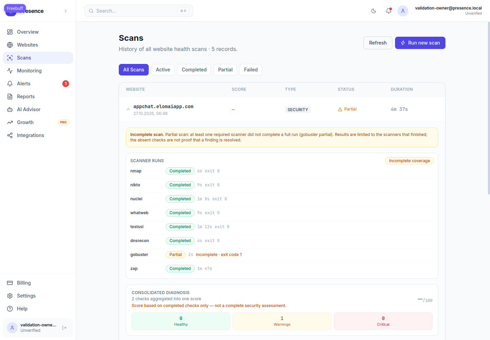
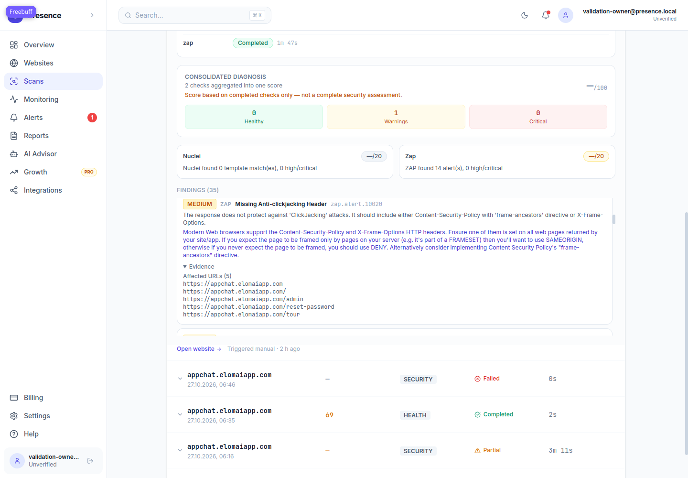
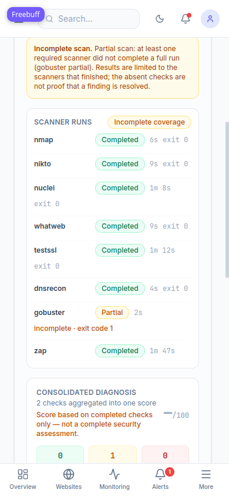
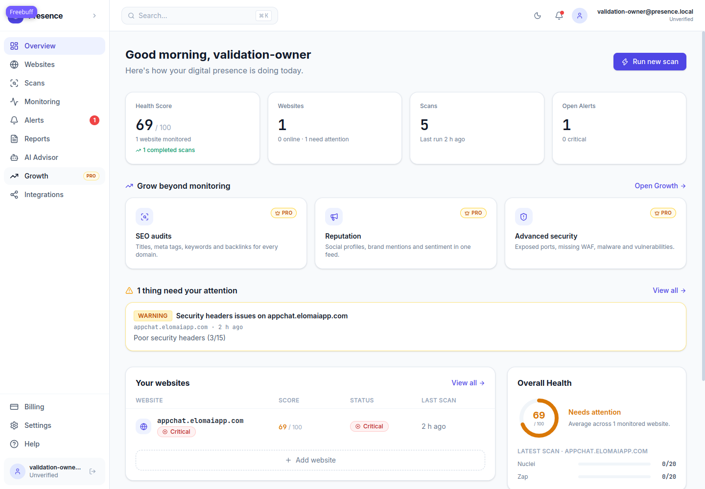

# Presence — Validation de l'interface des scans après intégration des scanners

Date : 2026-10-27
Périmètre : pile Docker locale `saas_web_application_digitale_presenz`
Rapport précédent : [`PRESENCE_ADVANCED_SCANNERS_INSTALLATION_2026-10-27.md`](PRESENCE_ADVANCED_SCANNERS_INSTALLATION_2026-10-27.md)

Aucun déploiement, aucune suppression de données, aucun scan Internet lancé.
Les données historiques (scans 1 à 5) n'ont pas été modifiées.

---

## 1. Environnement réellement utilisé

| Élément | Valeur observée |
| --- | --- |
| Dépôt | `/home/elom/Schreibtisch/SaaS_Web_Application_digitale_presenz` |
| Branche | `main`, modifications locales préexistantes conservées |
| Pile | `web`, `celery-worker`, `celery-beat`, `frontend`, `db`, `redis`, `mailpit`, `wordpress` |
| API | `https://localhost/api/v1/` (nginx, certificat auto-signé) |
| Frontend de test | `http://localhost:5173` (serveur Vite du projet, proxy `/api` → `https://localhost`) |
| Frontend servi | `https://localhost` reconstruit après correctifs |
| Pile isolée | `presence-validation` laissée intacte |

Le navigateur du poste refuse le certificat auto-signé de `https://localhost`
(`chrome-error://chromewebdata`). Le parcours a donc été exécuté sur le serveur
de dev Vite, qui est le mécanisme prévu par `playwright.config.ts` (« the
self-signed TLS certificate of https://localhost never reaches the test
browser »). Le build de production a ensuite été reconstruit et son chunk
`Scans-*.js` vérifié : il contient bien les correctifs.

### Données disponibles (réutilisées, non créées)

| Scan | Type | Statut | Durée | Détail |
| --- | --- | --- | --- | --- |
| 5 | security | `partial` | 4 m 37 s | 7 scanners complets + gobuster partiel (exit 1) |
| 4 | security | `failed` | 0 s | 8 scanners `unavailable` |
| 3 | health | `completed` | 2 s | score 69, lighthouse `unavailable` |
| 2 | security | `partial` | 3 m 11 s | testssl `timeout`, nikto/gobuster partiels, nuclei `host_unresponsive` |
| 1 | security | `partial` | 3 m 52 s | testssl `timeout`, nikto/gobuster partiels |

Site : `appchat.elomaiapp.com` (organisation personnelle de
`validation-owner@presence.local`). Aucun scan n'a été relancé : la mission
interdit les nouveaux scans Internet sans autorisation explicite.

---

## 2. Parcours navigateur réel

Connexion effectuée dans le formulaire (`/login`) avec le compte de validation,
puis :

1. `/app/dashboard` — score, état du site, dernière activité.
2. `/app/scans` — liste, filtres, ouverture d'un scan.
3. Détail du scan 5 (`partial`) — bannière, scanners, diagnostic, constats.
4. Détail du scan 3 (`completed`) — santé, 7 checks, lighthouse indisponible.
5. Détail du scan 4 (`failed`) — motif d'échec et 8 scanners indisponibles.
6. Détail du scan 1 — testssl `Timeout` avec durée et motif.
7. Filtres `Completed` (1), `Partial` (3), `Failed` (1).
8. Largeur desktop 1440 px et mobile 390 × 844 px.
9. Rechargement complet de la page, puis vérification de la console et du réseau.

Aucune erreur JavaScript, aucune requête API en échec pendant le parcours.
Les compteurs affichés (5 scans, 35 constats, 8 runs) correspondent aux
réponses API observées.

---

## 3. Défauts constatés et corrigés

### 3.1 Constats testssl sans identifiant (données fausses)

**Constaté** : deux lignes `TLS check:` / `testssl.` identiques, sans description,
alors que le rapport testssl contient 17 contrôles réels.

**Cause racine** : `testssl --jsonfile-pretty` imbrique les contrôles dans des
sections (`scanResult` → `pretest`, `ciphers`, `cipherTests`, …). Le parseur
lisait `scanResult` comme une liste de contrôles : il produisait un constat par
*section*, sans `id`, et perdait tous les contrôles internes.

**Correction** : parcours récursif du document, conservation des objets portant
`id` + `severity`, déduplication (les listes de ciphers apparaissent dans deux
sections), et regroupement par résultat pour ne pas dupliquer le même contrôle
sur les deux adresses Cloudflare. Le parseur plat reste accepté.

**Preuve sur données réelles** : le rapport archivé du scan 5 contient
9 identifiants uniques (`engine_problem`, `cipherlist_AVERAGE`, …) là où le
parseur n'en extrayait aucun.

**Limite** : les deux lignes historiques du scan 5 restent visibles — les
données ne sont pas réécrites. Le correctif s'applique aux prochains scans.

### 3.2 HTML brut dans les descriptions ZAP

**Constaté** : `The response does not protect…` était précédé de `
` et les
paragraphes adjacents se collaient (`site/app.If you expect…`).

**Correction** : `plainText()` dans `src/lib/format.ts` — séparation des blocs,
puis extraction via `DOMParser` (document inerte, aucun `dangerouslySetInnerHTML`).
Appliqué au titre, à la description et à la recommandation.

### 3.3 Motif d'incomplétude invisible par scanner

**Constaté** : gobuster affichait `Partial · exit 1` sans explication ; le motif
`metadata.partial_reason` existait en base mais n'était pas rendu.

**Correction** : `scannerRunReasonLabel()` traduit `timeout`, `exit_code_N`,
`empty_report`, `unparsable_report`, `host_unresponsive`, etc. Affichage
`incomplete · <motif>` (ambre pour partiel, rouge pour échec/timeout).
Vérifié : gobuster « incomplete · exit code 1 », testssl « incomplete · timed out »
avec durée 50 s.

### 3.4 Tri des sévérités alphabétique côté API

**Constaté par lecture de l'API et test déterministe** : `order_by("-severity")`
trie des libellés, donc `medium` passe avant `low`, et surtout `high`/`critical`
passent **après** `info`. Invisible sur le scan 5 (aucun high/critical).

**Correction** : annotation `Case/When` explicite (critical 5 → info 1), puis
catégorie et code. Test de régression couvrant les cinq niveaux.

### 3.5 Site « Never scanned » après un scan de sécurité

**Constaté** : le tableau de bord affichait « Never scanned », « No health score
yet » et un score vide alors que le scan santé 3 avait produit 69/100. Le scan 5
(sécurité, sans score) était pris comme « dernier scan » du site.

**Correction** : `health_score`/`health_status` proviennent désormais du dernier
scan **ayant produit un score** ; `last_scan_at`/`last_scan_id` restent le
dernier essai. Vérifié dans le navigateur : 69/100, « Critical », « 2 h ago ».

### 3.6 Preuves absentes de l'interface

**Constaté** : les preuves utiles (URL affectées par ZAP, adresses testssl)
n'étaient pas affichées ; seul le texte du constat apparaissait.

**Correction** : bloc `Evidence` repliable, borné (5 URL max + total, adresses,
valeurs détectée/attendue), sans JSON brut ni HTML. Vérifié : « Affected URLs (5) ».

---

## 4. Fichiers modifiés

| Fichier | Modification |
| --- | --- |
| `backend/scanners/parsers/testssl.py` | aplatissement des sections, déduplication |
| `backend/scanners/implementations/testssl.py` | regroupement par contrôle, adresses dans la preuve |
| `backend/scans/views.py` | tri explicite des sévérités |
| `backend/websites/serializers.py` | score santé issu du dernier scan noté |
| `backend/scanners/tests/test_advanced_tool_adapters.py` | fixture testssl imbriquée + test |
| `backend/scans/tests/test_scanner_engine.py` | test d'ordre des sévérités |
| `backend/websites/tests/test_website_api.py` | test de survie du score santé |
| `frontend/src/lib/format.ts` | `plainText`, `scannerRunReasonLabel` |
| `frontend/src/pages/Scans.tsx` | texte nettoyé, motif par scanner, preuves, libellé scanner |

Les images `web`, `celery-worker` et `frontend` ont été reconstruites et ces
services recréés sans toucher aux volumes, à la base ni aux autres projets.

---

## 5. Résultats des vérifications

### Automatisés (exécutés après les correctifs)

| Commande | Résultat |
| --- | --- |
| `bash scripts/run_backend_tests.sh scanners scans websites` | **407 tests, OK** |
| `bash scripts/run_backend_tests.sh scanners.tests.test_advanced_tool_adapters scans.tests.test_scanner_engine websites.tests.test_website_api` | **152 tests, OK** |
| `python manage.py check` | aucune anomalie |
| `python manage.py makemigrations --check --dry-run` | aucune migration détectée |
| `pnpm exec tsc --noEmit` | OK |
| `pnpm run build` | OK (prerender inclus) |
| `docker compose config --quiet` | OK |
| Chunk `Scans-*.js` servi | contient `Evidence`, `Affected URLs`, `incomplete ·` |

### Manuels (navigateur, données réelles)

| Vérification | Résultat observé |
| --- | --- |
| Liste des scans | 5 enregistrements, types et statuts corrects |
| Filtre `Completed` | 1 scan (santé, 69) |
| Filtre `Partial` | 3 scans |
| Filtre `Failed` | 1 scan |
| Scan `partial` | bannière explicite, 7 complets + gobuster partiel motivé |
| Scan `failed` | motif complet + 8 scanners indisponibles avec erreur |
| Scan `completed` | 7 checks, 69/100, lighthouse « Unavailable » motivé |
| Constats | 35, sévérités medium → low → info, libellé scanner, texte propre |
| Preuves | URLs affectées visibles, aucune donnée d'un autre tenant |
| Console | aucune erreur JS, requêtes API 200 |
| Mobile 390 px | aucun débordement horizontal, motif visible |

### Captures

---

## 6. Non vérifié / limites

- **Aucun nouveau scan** : l'autorisation de scanner une cible externe n'était
  pas donnée dans cette mission. La correction testssl est prouvée sur le
  rapport réel archivé et par test, pas par un nouveau scan complet.
- **Lignes testssl historiques** : le scan 5 conserve ses deux constats vides ;
  les données n'ont pas été réécrites.
- **Isolation multi-tenant** : couverte par les tests automatisés
  (`/scans/{id}/scanner-runs/`, `/findings/` renvoient 404 pour un autre
  utilisateur) et par un accès non authentifié (401), mais non rejouée avec un
  second compte réel pour ne pas créer de données.
- **Scanner optionnel** : lighthouse apparaît « Unavailable » sans mention
  « optionnel », car l'API n'expose pas la politique de couverture. Aucune
  information n'a été inventée côté interface.
- **Navigateur** : Chromium uniquement ; Firefox/Safari non testés.
- **Playwright E2E** : non exécuté (le parcours a été fait dans le navigateur
  intégré ; la suite E2E du projet cible l'inscription et Mailpit).
- Le scan 5 reste `partial` : c'est le comportement correct (gobuster n'a pas
  prouvé la couverture), et non une régression.

---

## 7. Conclusion

L'utilisateur peut ouvrir un scan de sécurité dans Presence, lire son statut réel,
voir quels scanners ont réussi, échoué ou expiré, comprendre pourquoi la
couverture est incomplète, et consulter les constats avec leurs preuves.
Les trois défauts d'affichage démontrés, le tri des sévérités et la perte du
score santé sont corrigés et couverts par des tests. Les données historiques
restent intactes, y compris leurs imperfections.
